<div align="center">

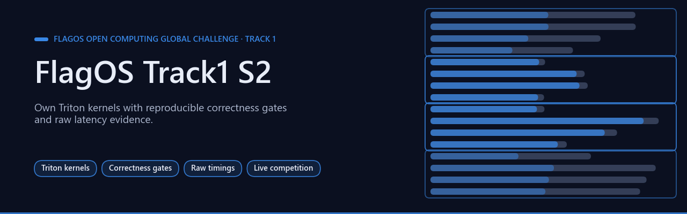

# FlagOS Track1 S2 — controlled Triton kernels

[](https://github.com/Agnuxo1/FlagOS-Track1-S2/actions/workflows/evidence.yml) [](LICENSE)   [](results/) [](https://www.kaggle.com/competitions/flag-os-open-computing-global-challenge-track-1)

[**Task 177**](#live-batch-11-candidate-strided-zimage-qk-rmsnorm) · [**Tiling**](#measured-improvement-sigmoid-gate-tiling) · [**Operators**](#three-further-kernel-implementations) · [**Official status**](#official-entry-status-and-dates) · [**Reproduce**](#reproduction-and-provenance) · [**Task 177 results**](results/task177-20261029) · [**Experiment log**](experiments/LOG.md) · [**Track 2**](https://github.com/Agnuxo1/FlagOS-Track2-S2) · [**Bibliography**](#bibliography)

</div>

Own Triton optimization candidates for [FlagOS Open Computing Global Challenge, Track1](https://www.kaggle.com/competitions/flag-os-open-computing-global-challenge-track-1), with reproducible correctness gates and raw latency evidence.

**Contents** — [Background](#background) · [Live Batch 11 candidate: strided ZImage QK RMSNorm](#live-batch-11-candidate-strided-zimage-qk-rmsnorm) · [Measured improvement: sigmoid-gate tiling](#measured-improvement-sigmoid-gate-tiling) · [Three further kernel implementations](#three-further-kernel-implementations) · [Official entry status and dates](#official-entry-status-and-dates) · [Real-world applications](#real-world-applications) · [Possible improvements](#possible-improvements) · [Proposed next steps (not commitments)](#proposed-next-steps-not-commitments) · [Reproduction and provenance](#reproduction-and-provenance) · [Bibliography](#bibliography)

## Background

<p align="center">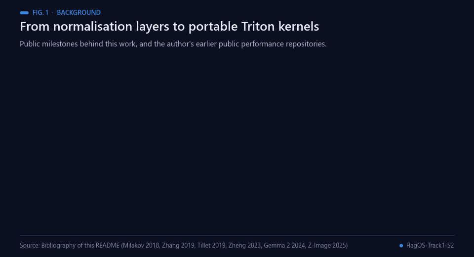<br><sub>Fig. 1 — Milestones behind this work. Sources: bibliography below.</sub></p>

RMS normalisation rescales each row by its root mean square instead of re-centring it as Layer Normalization does
[[1](#ref-1), [2](#ref-2)]. Such normalisation sits in front of the attention and feed-forward blocks of Transformers
[[3](#ref-3)], and some models also normalise attention queries and keys before the dot product [[4](#ref-4)]. Gemma 2
bounds its logits with soft-capping, a scaled tanh [[5](#ref-5)]; the `softcap_row_argmax` kernel implements that
arithmetic followed by an argmax over a vocabulary row. Task 177 is named after the Z-Image model family [[6](#ref-6)].

These operators are typically small and memory-bound (not measured here), so launch geometry, meaning how many rows a
Triton program [[7](#ref-7)] handles and with how many warps, can matter more than arithmetic; the roofline model
[[8](#ref-8)] gives the usual vocabulary. Splitting a vocabulary row across programs relies on the idea behind the
online softmax of Milakov and Gimelshein [[9](#ref-9)]: partial reductions over chunks can be merged exactly (here the
maximum, with first-index tie handling). Every comparison against a reference uses the SGLang kernels
[[10](#ref-10), [11](#ref-11)], retained under their Apache-2.0 licence, except task 177, where the control is our own one-row
kernel; bf16 rounding follows the bfloat16 format [[12](#ref-12)].

Measurement practice follows common benchmarking guidance: ratios are summarised with geometric means [[13](#ref-13)],
timing rounds are interleaved and every case is reported [[14](#ref-14)], and acceptance gates were fixed before
measuring, in the spirit of preregistration [[15](#ref-15)]. The sigmoid-gate and operator experiments were executed on
28 October 2026 (`experiments/LOG.md`); registration and the task 177 entries are dated 29 October 2026 in this
README.

The author's earlier public repositories on GPU computation and performance engineering include CHIMERA, deep
learning expressed on OpenGL [[16](#ref-16)], pixelflow, GPU texture reservoir computing with CPU, OpenGL and CUDA
backends [[17](#ref-17)], and QueryFoundry, an entry for a Kaggle database-performance challenge [[18](#ref-18)]. The sister
repository [FlagOS-Track2-S2](https://github.com/Agnuxo1/FlagOS-Track2-S2) [[19](#ref-19)] applies the same evidence-first workflow to MiniCPM5-2B serving in
Track 2.

## Live Batch 11 candidate: strided ZImage QK RMSNorm

<p align="center">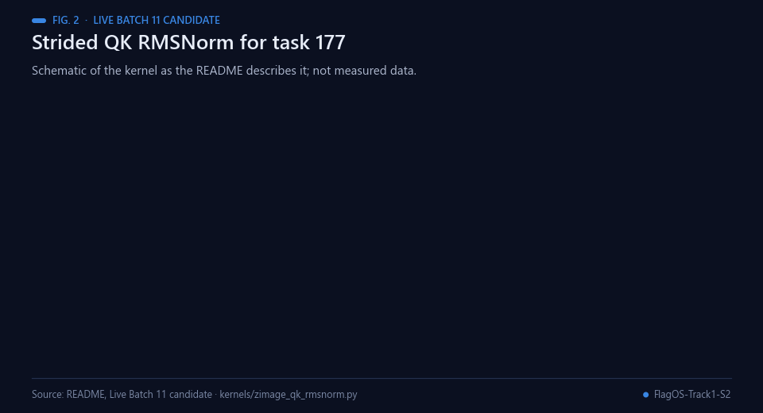<br><sub>Fig. 2 — Schematic of the task 177 kernel as described below; not measured data.</sub></p>

The newly registered team now targets **task 177, `zimage_qk_rmsnorm`**. This
adapts our packed-row RMSNorm to the official bf16/128-column interface,
reads fused-QKV slices without a contiguous input copy, and preserves the
required bf16 rounding before weight multiplication. Output is fresh and
contiguous. All core arithmetic runs in Triton, with no Torch math fallback.
RMSNorm's mathematical background is [Zhang & Sennrich, NeurIPS 2019](https://arxiv.org/abs/1910.07467);
that paper is not evidence for our measured packing speedups.

Three interventions were fixed before measuring. Each used six shapes,
two layouts, three fresh seeds and seven interleaved timing rounds. The
control is **our same-formula one-row Triton kernel**, not SGLang's production
baseline. Inputs are generated benchmark tensors; timing and correctness
measurements come from the actual RTX3090.

| Candidate | Exploratory geometric ratio | Fresh-seed confirmation ratio | Confirmation wins / ties / losses |
|---|---:|---:|---:|
| Z1: 4 rows, 4 warps | 1.130623× | **1.139398×** | 23 / 13 / 0 |
| Z2: 8 rows, 4 warps | **1.141692×** | 1.149730× | 24 / 11 / 1 |
| Z3: 16 rows, 8 warps | 1.140406× | 1.147811× | 24 / 11 / 1 |

<p align="center">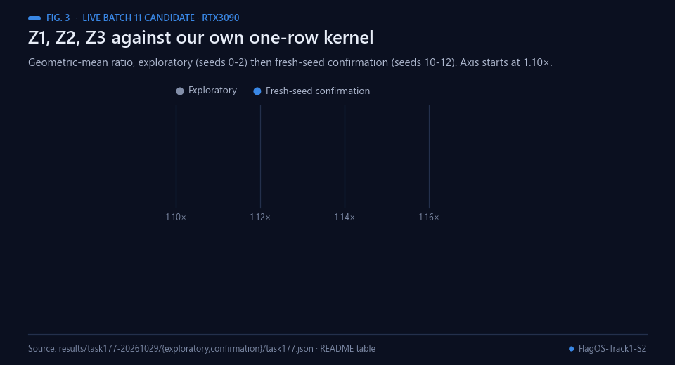<br><sub>Fig. 3 — Exploratory and fresh-seed confirmation ratios against our own one-row kernel (axis starts at 1.10×). Data: results/task177-20261029.</sub></p>

<p align="center">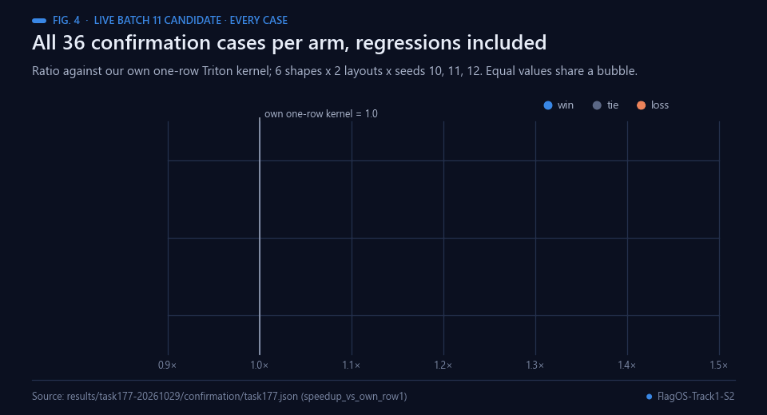<br><sub>Fig. 4 — Every confirmation case, ties and regressions included. Data: results/task177-20261029/confirmation.</sub></p>

Z1 was selected **before** confirmation (seeds 10/11/12), following the JEV
review, and remains the exported default. Faster Z2/Z3 aggregate results and
their regressions remain visible. All **288 numerical checks passed** across
the two phases, with maximum absolute difference 0.03125 against the official
Torch formula, within bf16 `rtol=.016,atol=1e-5`. These are tolerance checks,
not a bitwise equality claim. Microsecond event timings are quantised; ties
and this fixed shape panel limit interpretation. These ratios are not an
official multi-chip score.

[Full JSON and all 2016 timing rows](results/task177-20261029) ·
[Frozen exploratory protocol](evidence/task177-protocol-20261029.json)

```sh
python scripts/verify_task177.py  # independently reconstruct every recorded ratio on CPU
python bench/task177.py         # fresh GPU benchmark through the managed queue
```

## Measured improvement: sigmoid-gate tiling

<p align="center">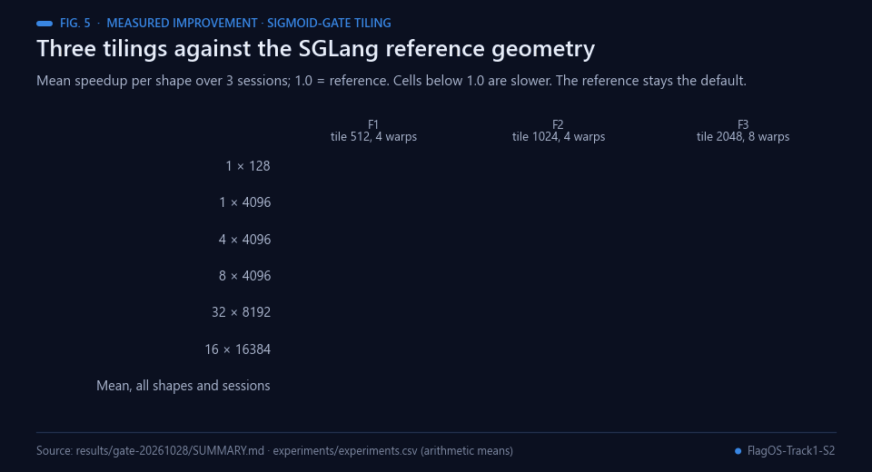<br><sub>Fig. 5 — Per-shape means from results/gate-20261028/SUMMARY.md; the reference stays the default.</sub></p>

Three fixed tiling interventions were executed on an RTX3090 against the SGLang reference geometry: one program per row, next-power-of-two block width and its width-dependent warp heuristic. All **72 correctness checks passed**. Each shape has three sessions,24 interleaved rounds/session and100 calls/sample. An independent CPU check reproduces every stored median and ratio from raw timings.

| Intervention | Arithmetic mean speedup over all shapes/sessions |
|---|---:|
| F1: tile512,4warps | **1.004398×** |
| F2: tile1024,4warps | 0.999799× |
| F3: tile2048,8warps | 1.001115× |

The positive shape-specific gains remain visible:

| Shape N×D | F1 speedup, mean over3sessions |
|---|---:|
| 1×128 | 0.9893× |
| 1×4096 | 1.0036× |
| 4×4096 | 1.0033× |
| 8×4096 | **1.0111×** |
| 16×16384 | 1.0051× |
| 32×8192 | **1.0140×** |

The reference remains the default: the small aggregate effect and small-shape regression do not support replacing it generally. A shape-specific dispatcher selected from these results would need prospective confirmation. This does not discard the measured positive effects. These are **one-GPU benchmark results, not an official multi-chip score**.

[All variants and shapes](results/gate-20261028/SUMMARY.md) · [Raw timings](results/gate-20261028/flagos_gate_raw.csv) · [Correctness/results](results/gate-20261028/flagos_gate_results.json)

```bash
python bench/controlled_gate.py       # rerun on a compatible CUDA GPU
python scripts/summarize_gate.py      # CPU-only independent reconstruction of saved results
```

## Three further kernel implementations

<p align="center">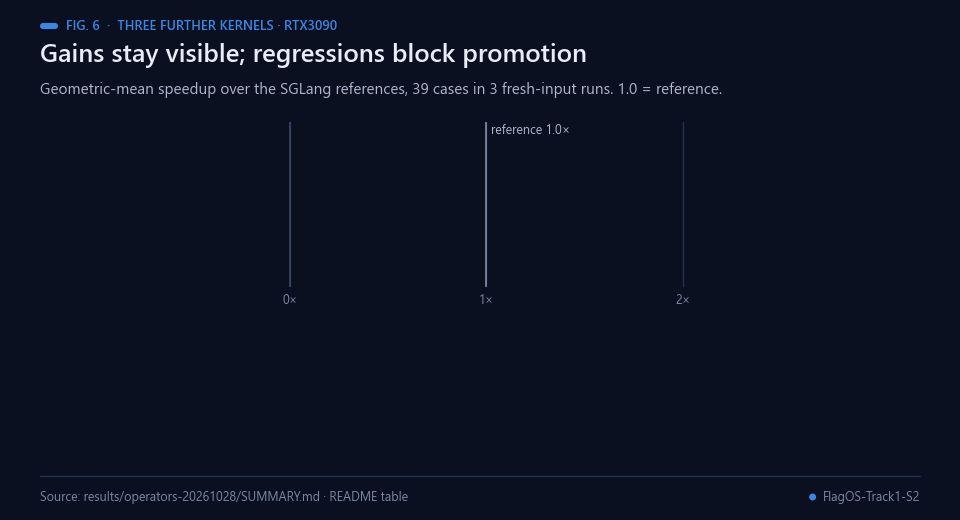<br><sub>Fig. 6 — Geometric mean per kernel over 15, 16 and 8 cases (39 in total) on one RTX3090; none meets the all-case gate.</sub></p>

These code changes implement distinct hypotheses against the included SGLang references:

| Candidate | Change | Validation status |
|---|---|---|
| `softcap_row_argmax` | Split a vocabulary row across programs and merge with first-index tie handling | Measured: 2.3577× geometric mean; wins every run on 12/15 cases |
| `rmsnorm_fp32` | Pack narrow rows and select warps from tile size | Measured: 1.0393× geometric mean; wins every run on 3/16 cases |
| `gemma_fused_add_rmsnorm` | Pack narrow residual-add/norm rows; retain the wide-row plan | Measured: 1.0548× geometric mean; wins every run on 3/8 cases |

GPU job `d1006ec4412e4f09` completed successfully on an RTX 3090. All 39 cases
passed correctness in each of three fresh-input runs. The raw file contains
585 paired timing rounds. The strongest measured per-case ratios are **9.9333×**
for softcap, **1.3929×** for RMSNorm and **1.5745×** for fused add/RMSNorm.

<p align="center">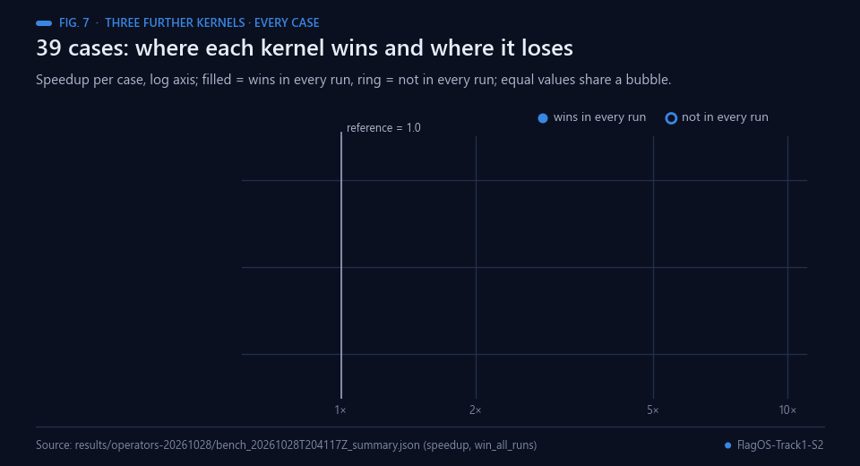<br><sub>Fig. 7 — Every case, wins and regressions. Data: results/operators-20261028.</sub></p>

The preregistered gate requires a speed win on **every tested case in every run**.
None meets that unconditional gate: worst-case ratios are respectively 0.9674×,
0.8889× and 0.9091×. The gains remain measured positive results; these regressions
prevent unconditional promotion. [All cases and run ranges](results/operators-20261028/SUMMARY.md)
are retained alongside raw timings. This is one CUDA GPU, not the official
multi-chip score. Microsecond timings and this fixed shape grid limit generalisation.

```bash
python -m pytest -q tests/test_kernels.py
python bench/bench.py --runs 3 --rounds 5 --out results
python scripts/summarize_operators.py  # reconstruct all 39 cases on CPU
```

## Official entry status and dates

<p align="center">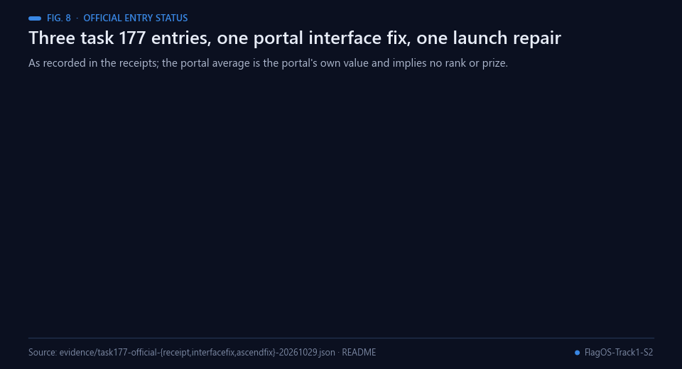<br><sub>Fig. 8 — The three official entries as recorded in the receipts under evidence/.</sub></p>

**Registration completed, 29 October 2026:** the official portal confirmed
“Registration Successful!” for **Agnuxo1Lab, Track 1**, with the author as captain.
The consent and contact details remain in the private operational record.
The first official code entry, `task177-z1.zip`, was submitted on 29 October
at 00:20 UTC. It completed with **0/7 chips**, rejected before numerical
evaluation: the portal requires a top-level function named after the operator,
`zimage_qk_rmsnorm`, rather than the task prose's `solution`. The submitted ZIP
was downloaded independently and matches the local SHA256 exactly; the
portal's 18.4 KB size display was not its actual byte count (1078 bytes).
[Recorded receipt](evidence/task177-official-receipt-20261029.json).

The corrected archive exports the required function. Arithmetic and launch
helpers are AST-identical to those used in the 288 successful local checks.
A regression test rejects the actual first archive and accepts the corrected
one. The first entry remains recorded as an interface failure, not a measured
numerical or performance regression.

**Corrected official entry, 29 October 00:30 UTC:** the portal confirms
`task177-z1-interfacefix.zip` submitted. Its **Completed** evaluation shows
**6/7 chips passing correctness**, with five positive official speedups:
**Iluvatar 12.17×, MetaX 2.17×, Hygon 8.60×, General A 7.19× and General B
6.42×**. Kunlunxin passes correctness but reports **<0.01×**. Ascend fails at
launch: its driver rejects grid dimension131072 because the maximum is65535.
All results remain in the [official receipt](evidence/task177-official-interfacefix-20261029.json).
No final average, leaderboard qualification or prize is claimed.

**Ascend-specific launch repair:** a bounded4096-program grid with a grid-stride
loop covers every row instead of dropping work. The generic file remains
byte-identical, preserving the five successful chip implementations. All
**36 new CUDA proxy checks** pass, including524288rows, the old grid boundary,
two layouts and three seeds. [Complete coverage results](results/task177-20261029/ascend-launch-coverage.json).
These checks establish numerical coverage on RTX3090. The subsequent official
evaluation below independently confirms Ascend correctness and performance.
Kunlunxin's low throughput is a separate, retained issue.

<p align="center">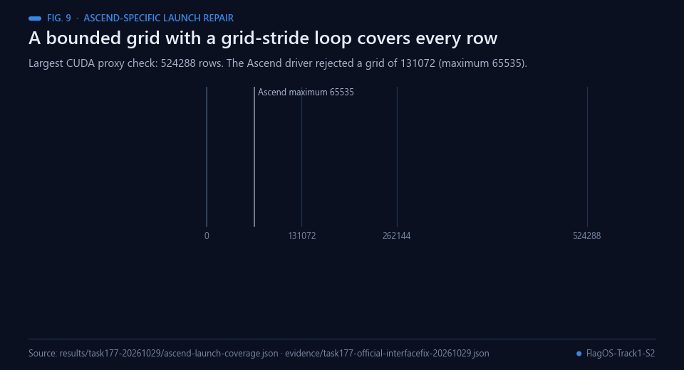<br><sub>Fig. 9 — Why a bounded grid with a grid-stride loop covers every row. Data: results/task177-20261029/ascend-launch-coverage.json.</sub></p>

The Ascend-only repair, `task177-z1-ascendfix.zip`, was officially submitted
on **29 October, 00:54 UTC**. Its official evaluation is now **Completed:
7/7 chips pass correctness; portal average speedup 5.48×**.

| Official evaluation chip | Speedup |
|---|---:|
| Iluvatar | 12.22× |
| MetaX | 2.52× |
| Hygon | 8.66× |
| Kunlunxin | <0.01× |
| Ascend | 1.30× |
| General-Purpose Chip A | 7.20× |
| General-Purpose Chip B | 6.46× |

<p align="center">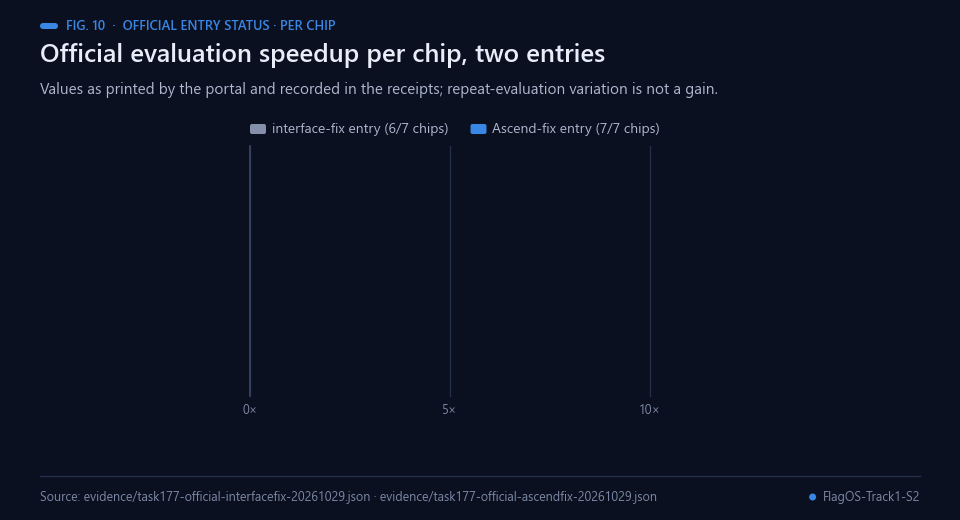<br><sub>Fig. 10 — Official evaluation per chip, as printed by the portal and recorded under evidence/.</sub></p>

[Third-entry receipt](evidence/task177-official-ascendfix-20261029.json).
The launch repair restores Ascend execution and the five earlier positive
speedups remain positive. Other-chip timing differences are repeat-evaluation
variation with byte-identical generic code, not gains attributed to the repair.
The 5.48× value is reported by the portal; we do not infer its aggregation
formula, leaderboard eligibility, rank or prize. Kunlunxin remains a substantial
performance regression despite passing correctness. Enflame is displayed as
unavailable, outside the seven evaluated chips.
The other ZIPs under `submissions/` remain prepared candidates.

<p align="center">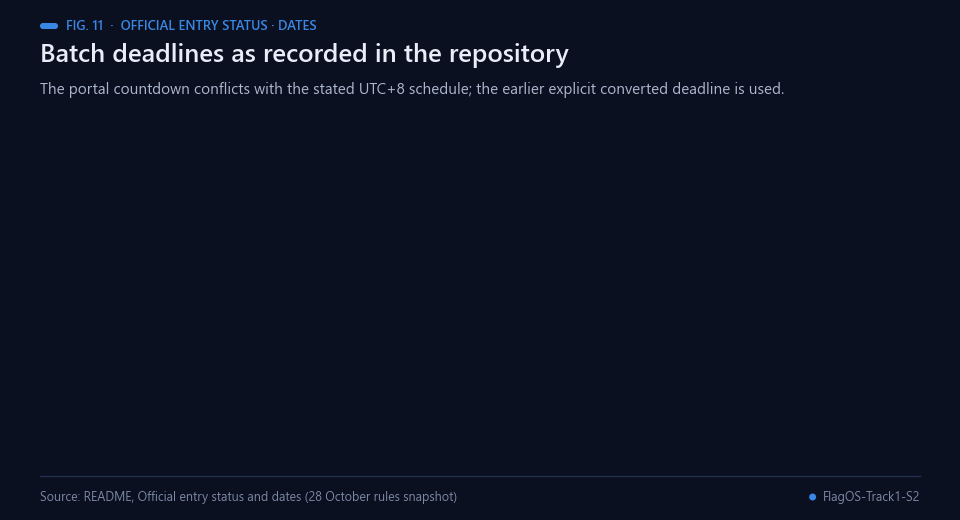<br><sub>Fig. 11 — Deadlines as recorded here; the earlier explicit converted deadline is used.</sub></p>

The current submission selector exposes **Batch 11, tasks161–177**. Our older
softcap/RMSNorm candidates cannot be uploaded under a different task name.
The exact released task contract must match before an official code upload.
Batch11 closes **29October19:59:59UTC+8 (12:59:59Madrid)**. The portal's
countdown conflicts with the stated UTC+8 schedule; use the earlier explicit
converted deadline until the organiser resolves it.

The28October rules snapshot in the project evidence identifies batch12 development closing **5November19:59:59UTC+8**, batch13 closing **13November19:59:59UTC+8** (12:59:59Madrid), and registration ending13November23:59UTC+8. The later Kaggle container date must not be substituted for these platform batch deadlines. Official registration: [FlagOS portal](https://flagos.io/Register?raceId=8q4m2x7p&lang=en). Team/track exclusivity must be checked before entering both tracks.

## Real-world applications

<p align="center">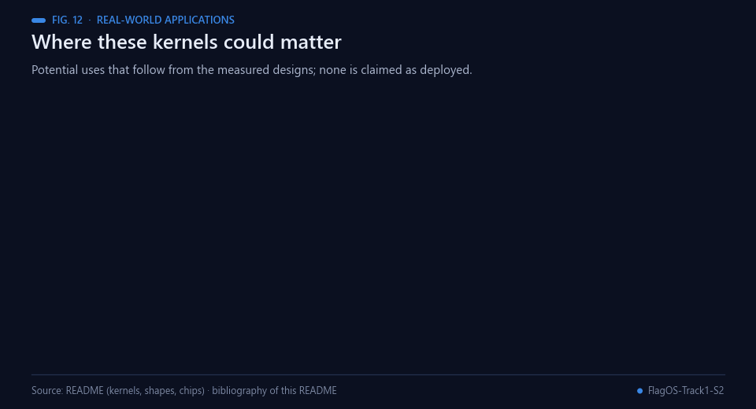<br><sub>Fig. 12 — Where these kernels could matter. Potential uses only; none is claimed as deployed.</sub></p>

The measured designs suggest the following uses; each would first need its own prospective confirmation.

- **Image-generation models.** QK normalisation of fused QKV slices read in place, as in the Z-Image operator of
  task 177 [[6](#ref-6), [4](#ref-4)]. The official evaluation reports speedups above 1× on six of seven chips, but its
  aggregation, rank and prize are not established here.
- **Decoding heads.** Soft-capped argmax over large vocabularies [[5](#ref-5)]: 2.3577× geometric mean over all 15 cases on
  one RTX3090, not an official score. The kernel loses at 256 rows and does not meet the every-case gate; gains of
  1.1346× to 9.9333× occur at 1 to 64 rows.
- **Per-head normalisation.** Narrow rows (D = 128) are packed so that one program handles several rows.
- **Serving stacks.** Candidates for stacks that ship SGLang-style kernels [[10](#ref-10)], once a shape-specific
  dispatcher is confirmed prospectively.
- **Seven evaluated chips.** One Triton kernel family [[7](#ref-7)], with an Ascend-specific launch variant, was evaluated
  on seven chips through the official portal; the single-file interface-fix entry failed on Ascend, and Kunlunxin
  passes correctness but is slow.
- **Benchmark practice.** Raw timings, CPU-only reconstruction and kept regressions [[14](#ref-14)] can serve as a
  template for kernel reports.

## Possible improvements

<p align="center">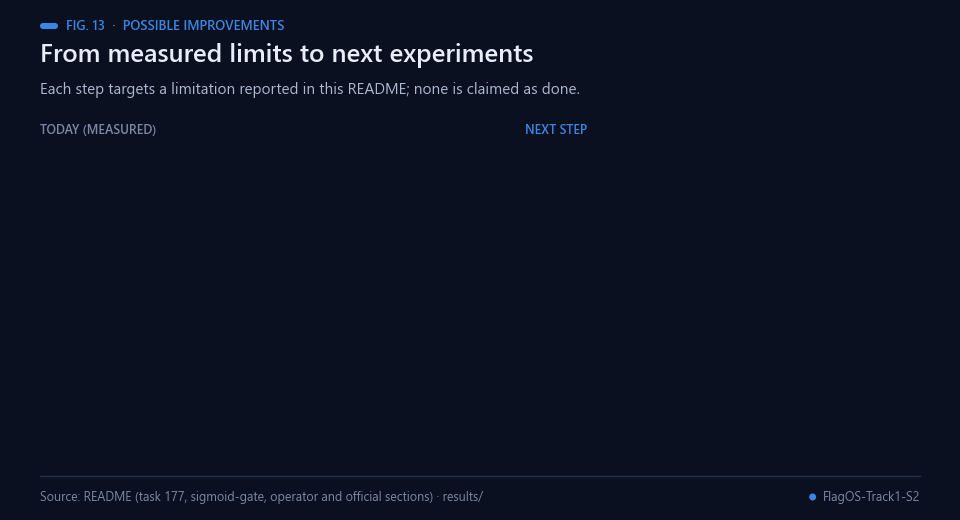<br><sub>Fig. 13 — Each improvement targets a limitation reported in this repository.</sub></p>

- **Kunlunxin performance.** Task 177 passes correctness on Kunlunxin but reports <0.01× in both official
  evaluations that include it; profiling that chip's execution of the packed kernel, and testing a chip-specific
  variant, are possible first steps.
- **Control and baseline.** The task 177 control is our own one-row Triton kernel, not SGLang's production kernel
  [[11](#ref-11)]; a comparison on identical inputs and layouts would show the gain over the baseline that matters.
- **Shape-specific behaviour.** Softcap loses at 256 rows (0.9674× to 0.9825×), the sigmoid-gate tiling F1 loses at
  1×128 (0.9893×) and the packed RMSNorm kernels win mostly on narrow rows. A shape-selecting dispatcher needs
  prospective confirmation before it replaces any default.
- **Resolution of the timing.** Microsecond event timings are quantised and the shape panels are fixed; wider
  panels with more rounds would resolve small differences and ties [[14](#ref-14)].

## Proposed next steps (not commitments)

<p align="center">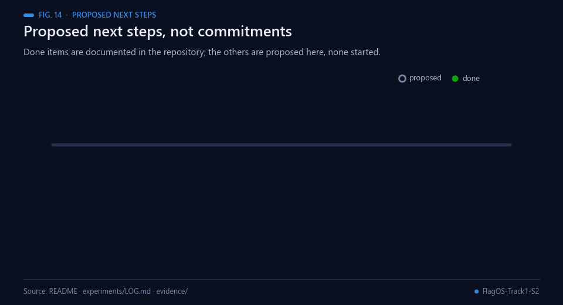<br><sub>Fig. 14 — Completed milestones are documented in this repository; the rest are proposed.</sub></p>

Possible next steps, proposed here and not committed by the authors; none is started:

1. Investigate the Kunlunxin result (<0.01×) on the packed kernel.
2. Compare the task 177 candidate with SGLang's production kernel on identical inputs.
3. Build and confirm prospectively a shape-selecting dispatcher for the tiling and operator candidates.
4. Repeat the fixed shape panels with wider coverage and more rounds.
5. Prepare candidates only for tasks whose released contract matches exactly (the selector currently exposes Batch 11,
   tasks 161–177), and check team and track exclusivity before also entering Track 2 ([repository](https://github.com/Agnuxo1/FlagOS-Track2-S2)).

## Reproduction and provenance

<p align="center">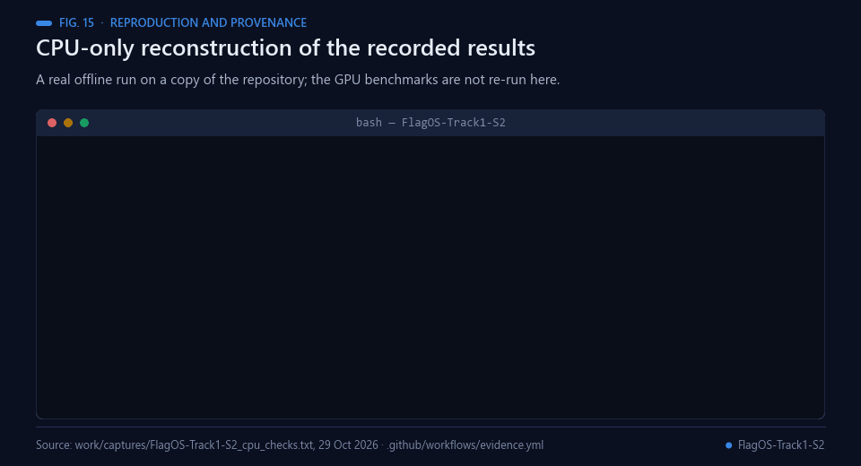<br><sub>Fig. 15 — A real offline run on a copy of the repository; GPU benchmarks are not re-run.</sub></p>

Requires a compatible PyTorch/Triton CUDA environment. The executed gate result records exact software versions and GPU. Candidate benchmarks use the same input seeds and shapes for reference and optimized code, with correctness checked before timing. Run heavy jobs through the server queue; no GPU on the Windows workstation is needed.

This project extends the author's existing local kernel line and publishes the actual optimization code and evidence. The reference kernels are from [SGLang](https://github.com/sgl-project/sglang), retained under Apache-2.0 with their licence in `reference/LICENSE.sglang`. The gate reference geometry is documented in [SGLang sigmoid-gate implementation](https://github.com/sgl-project/sglang/blob/main/python/sglang/kernels/ops/moe/triton_sigmoid_gate_mul.py).

Code: Apache-2.0. Author: Francisco Angulo de Lafuente.

## Bibliography

1. <a id="ref-1"></a>Ba, J. L., Kiros, J. R., & Hinton, G. E. (2016). Layer Normalization. *arXiv* 1607.06450. https://arxiv.org/abs/1607.06450
2. <a id="ref-2"></a>Zhang, B., & Sennrich, R. (2019). Root mean square layer normalization. *Advances in Neural Information Processing Systems 32 (NeurIPS 2019)*. https://arxiv.org/abs/1910.07467
3. <a id="ref-3"></a>Xiong, R., Yang, Y., He, D., et al. (2020). On Layer Normalization in the Transformer Architecture. *arXiv* 2002.04745. https://arxiv.org/abs/2002.04745
4. <a id="ref-4"></a>Henry, A., Dachapally, P. R., Pawar, S., & Chen, Y. (2020). Query-Key Normalization for Transformers. *arXiv* 2010.04245. https://arxiv.org/abs/2010.04245
5. <a id="ref-5"></a>Gemma Team, Riviere, M., Pathak, S., et al. (2024). Gemma 2: Improving open language models at a practical size. *arXiv* 2408.00118. https://arxiv.org/abs/2408.00118
6. <a id="ref-6"></a>Z-Image Team, Cai, H., Cao, S., et al. (2025). Z-Image: An efficient image generation foundation model with single-stream diffusion transformer. *arXiv* 2511.22699. https://arxiv.org/abs/2511.22699
7. <a id="ref-7"></a>Tillet, P., Kung, H. T., & Cox, D. (2019). Triton: an intermediate language and compiler for tiled neural network computations. *Proceedings of the 3rd ACM SIGPLAN International Workshop on Machine Learning and Programming Languages*, 10–19. https://doi.org/10.1145/3315508.3329973
8. <a id="ref-8"></a>Williams, S., Waterman, A., & Patterson, D. (2009). Roofline: an insightful visual performance model for multicore architectures. *Communications of the ACM*, 52(4), 65–76. https://doi.org/10.1145/1498765.1498785
9. <a id="ref-9"></a>Milakov, M., & Gimelshein, N. (2018). Online normalizer calculation for softmax. *arXiv* 1805.02867. https://arxiv.org/abs/1805.02867
10. <a id="ref-10"></a>Zheng, L., Yin, L., Xie, Z., et al. (2023). SGLang: Efficient Execution of Structured Language Model Programs. *arXiv* 2312.07104. https://arxiv.org/abs/2312.07104
11. <a id="ref-11"></a>SGLang contributors (2026). *SGLang* [Software repository, Apache-2.0 licence]. GitHub. https://github.com/sgl-project/sglang
12. <a id="ref-12"></a>Kalamkar, D., Mudigere, D., Mellempudi, N., et al. (2019). A Study of BFLOAT16 for Deep Learning Training. *arXiv* 1905.12322. https://arxiv.org/abs/1905.12322
13. <a id="ref-13"></a>Fleming, P. J., & Wallace, J. J. (1986). How not to lie with statistics: the correct way to summarize benchmark results. *Communications of the ACM*, 29(3), 218–221. https://doi.org/10.1145/5666.5673
14. <a id="ref-14"></a>Hoefler, T., & Belli, R. (2015). Scientific benchmarking of parallel computing systems. *Proceedings of the International Conference for High Performance Computing, Networking, Storage and Analysis*, 1–12. https://doi.org/10.1145/2807591.2807644
15. <a id="ref-15"></a>Nosek, B. A., Ebersole, C. R., DeHaven, A. C., & Mellor, D. T. (2018). The preregistration revolution. *Proceedings of the National Academy of Sciences*, 115(11), 2600–2606. https://doi.org/10.1073/pnas.1708274114
16. <a id="ref-16"></a>Angulo de Lafuente, F. (2025). *CHIMERA v3.0: deep learning on OpenGL* [Software repository, MIT licence]. GitHub. https://github.com/Agnuxo1/CHIMERA-Revolutionary-AI-Architecture---Pure-OpenGL-Deep-Learning
17. <a id="ref-17"></a>Angulo de Lafuente, F. (2026). *pixelflow: GPU texture reservoir computing* [Software repository]. GitHub. https://github.com/Agnuxo1/pixelflow
18. <a id="ref-18"></a>Angulo de Lafuente, F. (2026). *QueryFoundry: verifiable performance and durable recovery* [Software repository, Apache-2.0 licence]. GitHub. https://github.com/Agnuxo1/QueryFoundry
19. <a id="ref-19"></a>Angulo de Lafuente, F. (2026). *FlagOS Season 2, Track 2: measured MiniCPM5-2B optimisation* [Software repository, Apache-2.0 licence]. GitHub. https://github.com/Agnuxo1/FlagOS-Track2-S2

---

<div align="center">
<sub>Built by <a href="https://github.com/Agnuxo1">Francisco Angulo de Lafuente</a> · every figure is an animated
rendering of the published file named in its footer · <a href="#flagos-track1-s2--controlled-triton-kernels">back to top ↑</a></sub>
</div>
