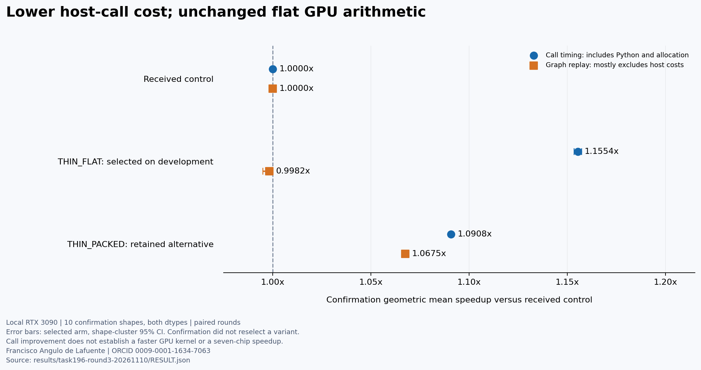

# Task196 follow-ups — 10 November 2026

The final controlled follow-up was officially received once and completed **7/7 chips, displayed average 2.72x**. The live table later showed **rank 11 of 21, Rank score 0.44**, observed 2026-11-10T09:47:34.381519+00:00. The earlier snapshot was 12/20; standings and participation changed during that interval. These are provisional observations. No honor, prize or final contest rank is claimed.

## Official results

| Chip | Initial entry | Final wrapper entry |
|---|---:|---:|
| Iluvatar | 4.46x | 4.27x |
| MetaX | 2.23x | 2.25x |
| Hygon | 3.73x | 3.86x |
| Kunlunxin | 1.52x | 1.52x |
| Ascend | 0.84x | 0.93x |
| General-Purpose Chip A | 3.06x | 3.09x |
| General-Purpose Chip B | 3.19x | 3.15x |
| Displayed average | 2.72x | 2.72x |

These are single native-evaluation displays. Some chips improved and others regressed; the average is unchanged at displayed precision. This is not a controlled significance test or evidence that all chips gained the local call speedup. Ascend remains slower than its reference. The live ranking uses reciprocal per-chip ranks before average speedup, so average alone does not determine position. See [structured native observations](../../results/task196-round3-20261110/NATIVE_RESULTS.json).

The new [1621-byte submitted ZIP](../../submissions/task196-round3-20261110.zip) was downloaded from the actual platform link and matched SHA256 `012e5cc40b0831c7deaf442e980ea3421a3592f2f93a29d71db4f08f06e8983a`. Its sole UTF-8 member is `bias_gelu_tanh.py`, SHA256 `318f05c5525159ce8db77cd46b9d379a3406ef098997362e454a593ff3f4ecfe`. The platform displayed no unique submission identifier. [Reception history](RECEIPT_HISTORY.png) retains both entries. The initial source/ZIP, README content and figures remain intact.

## Round2: retained negative result

Six fixed arms tested removal of grid-stride traversal and packed-row bias reuse on ten new development and ten new confirmation shapes, both dtypes. The frozen development choice retained CURRENT: no candidate met both the graph-improvement and call-noninferiority requirements. All 528 eager/graph checks and 7200 paired timing rows are retained. There was no official submission from this round. Packed4x256 later showed exploratory confirmation ratios 1.07868x for graph replay and 0.94390x for calls; that observation was not used to change the frozen choice.

## Round3: direct production wrappers

A separate hypothesis asked whether Python validation and variant dispatch explained avoidable call cost. CURRENT was compared with THIN_FLAT (same flat GPU kernel) and THIN_PACKED (same previously tested 4x256 kernel). The thin wrappers assume the official valid-input preconditions, as does the published reference; they allocate fresh output and always launch Triton. The numerical formula and required low-precision intermediate rounding are unchanged. There is no Torch core fallback, input mutation, evaluator detection or result cache.

Eight new development and ten new confirmation shapes, disjoint from both earlier panels, used fresh seeds and both dtypes. Each sample had 32 calls; three sessions used ten randomised paired rounds. Selection by call speed was fixed before confirmation. Eligibility required development call speed >=1.02x and graph speed >=0.98x. The final offer required confirmation call shape-cluster 95% CI lower >1.02 and graph CI lower >=0.98; no confirmation reranking occurred. Bootstrap resampled 10000 shape clusters while keeping both dtypes together. All 240 checks and 3240 raw rows passed independent replay. A fresh independent review checked source/job hashes, export AST, both CIs, raw coverage and exact-production smoke.

Selected THIN_FLAT: confirmation call ratio **1.15535x**, shape-cluster 95% CI **[1.15353,1.15728]**; graph ratio **0.99820x**, CI **[0.99509,1.00028]**. CUDA-event call intervals include Python enqueue pacing and output allocation; graph replay mostly excludes those costs. The GPU arithmetic is unchanged. The interval describes this authored case panel, not hardware/workload populations or official chips. The exact export inlined the measured wrapper body, then passed six new GPU cases, including input/bias aliasing, 3D layout and actual traversal beyond the 4096-program cap.

## Reproduce and inspect

- [Round2 protocol and runner](../../bench/task196-round2/PROTOCOL.json), [all raw rows](../../results/task196-round2-20261110/raw.csv) and [negative result](../../results/task196-round2-20261110/RESULT.json).
- [Round3 protocol and runner](../../bench/task196-round3/PROTOCOL.json), [all raw rows](../../results/task196-round3-20261110/raw.csv), [result](../../results/task196-round3-20261110/RESULT.json) and [provenance](../../results/task196-round3-20261110/PROVENANCE.json).
- [Exact final export](../../kernels/task196-thin-flat-20261110/bias_gelu_tanh.py), [production smoke source](../../bench/task196-round3/production-smoke/smoke.py) and [six-case result](../../results/task196-round3-20261110/SMOKE_RESULT.json).

Run each experiment from its own directory in a compatible Torch/Triton environment. Its output directory must not already exist. Use the normal managed GPU queue with the declared 15 minute outer/800 second internal bounds; do not repeat completed tickets as filler. A compatible official Triton/Triton-TLE stack is needed for each native chip. No further local tuning is proposed for this delivery.

## Sources and rights

Francisco Angulo de Lafuente · [ORCID](https://orcid.org/0009-0001-1634-7063). Code developed with Codex; earlier Claude/Codex work informed the experimental method. EGM reviews were independent and findings were checked by execution. Code and authored evidence are Apache-2.0; existing third-party notices and licenses remain intact. No new GELU algorithm is claimed.

- [Official competition/task portal](https://flagos.io/race-detail-season2?id=782kzq4m&lang=en), current Task196 contract, rules and native results observed 10 November 2026.
- [Kaggle rules, public-code-sharing clause 6.b](https://www.kaggle.com/competitions/flag-os-open-computing-global-challenge-track-1/rules).
- [Pinned official definition](https://github.com/flagos-ai/FlagGems-sglang/blob/e4df65cb3b68f57ca2a16b4153ab47e4d44a369a/definitions/bias_gelu_tanh.json).
- [Related GELU source, Apache-2.0](https://github.com/flagos-ai/FlagGems-sglang/blob/e4df65cb3b68f57ca2a16b4153ab47e4d44a369a/src/flaggems_sglang/ops/gelu_tanh_and_mul.py).

Public code is also shared through the competition-associated CPU Kaggle notebook. An official GitHub PR/CLA is a later conditional step if an Occupied honor is actually confirmed; none is inferred here.
