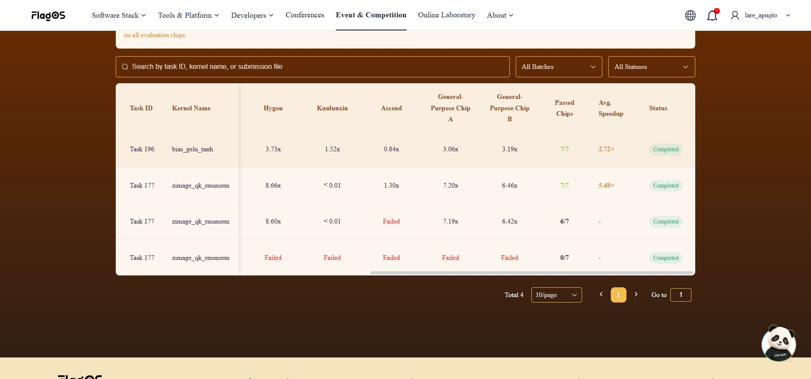
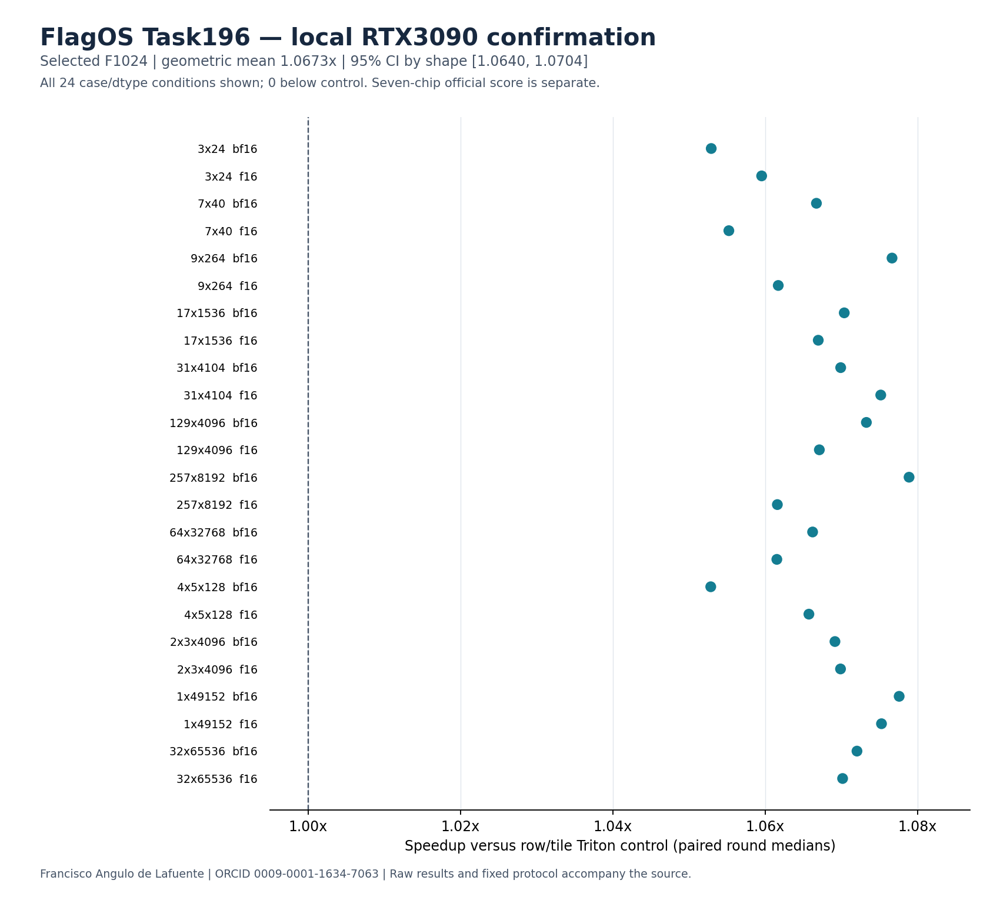

# Task196 — bias plus tanh GELU

The existing Agnuxo1Lab team submitted the exact reviewed kernel to the active FlagOS Batch13. **Task196, observed 2026-11-10T08:16:01.473712+00:00**. The platform displayed no unique submission identifier. Reception and the downloaded archive's exact SHA256 are confirmed.

## Official operator evaluation

The official history shows **Completed, 7/7 chips passed, average speedup 2.72x**. Per-chip speedups: Iluvatar 4.46x, MetaX 2.23x, Hygon 3.73x, Kunlunxin 1.52x, Ascend 0.84x, General-Purpose Chip A 3.06x and Chip B 3.19x. Enflame displays a dash and is not one of the seven counted chips. Ascend is slower than its official reference. These are displayed operator-evaluation values; no contest rank, honor or prize is claimed.

[Reception screenshot](FLAGOS_RECEIPT_FULL.png) and the structured official evaluation in [PROVENANCE.json](../../results/task196-20261110/PROVENANCE.json) are retained. The original ZIP downloaded from the platform matched the reviewed archive exactly.

## Contract

For nonempty contiguous fp16/bf16 x[...,H] and bias[H] with H divisible by 8, add in fp32 and round that sum to the input dtype before tanh GELU. The implementation preserves this intermediate rounding, returns fresh output and does not change either input. Core arithmetic always runs in Triton; there is no Torch fallback. The bounded grid covers every element, including non-power-of-two widths and multiple leading dimensions.

## Controlled local experiment

The fixed protocol compared the exact published PyTorch reference, a row/tile Triton control and three flat tile sizes. Eight development shapes selected one variant before twelve independent confirmation shapes were measured. Both dtypes and four additional adversarial panels were retained. Three timing sessions used twelve randomised rounds each; each sample contained twenty calls. Speedups pair the same session/round, then take a case median and a geometric mean over cases. Selection required at least 1.02x on development data or retained the baseline. Confirmation never reselected a variant. A fixed-seed, 10000-replicate bootstrap kept the two dtypes of each shape together. All 240 local correctness checks and six exact packaged-export smoke cases passed. All 7200 timing rows, including slowdowns, are retained.

Selected **F1024**. Confirmation geometric mean **1.06734x versus the row/tile control**, shape-cluster 95% CI **[1.06399, 1.07037]**; **2.07133x versus the exact PyTorch reference**. CUDA-event intervals include Python enqueue pacing and per-call output allocation; these are call timings within this harness, not isolated kernel-only latency. These are authored-case RTX 3090 measurements, separate from the official seven-chip values above. The interval describes this fixed case panel, not hardware or workload populations.

## Reproduce

The exact experimental files are in ../../bench/task196/ and the selected public export is ../../kernels/bias_gelu_tanh.py. Run the experiment in a compatible Torch/Triton GPU environment using the managed server queue, preserving PROTOCOL.json. It creates a new output directory and refuses to overwrite one. A compatible official Triton/Triton-TLE environment is required for the seven competition chips. The submitted ZIP is ../../submissions/task196-20261110.zip; its SHA256 is `79fec0254a9a04b7d4fbb728c81d8329cea3343d4f576d5b42e0ebe716545233`. Source, result, selection and export hashes are in ../../results/task196-20261110/PROVENANCE.json.

## Public copies

[Competition-associated Kaggle notebook](https://www.kaggle.com/code/franciscoangulo/flagos-task196-portable-bias-plus-gelu) · [Hugging Face source archive](https://huggingface.co/datasets/Agnuxo/flagos-task196-source-archive-20261110)

The Kaggle notebook is public, associated with this competition, licensed Apache-2.0 and completed a CPU-only run. Its output kernel hash matches the submitted source. The Hugging Face archive is pinned to Git commit `1341e8d201bb83e8e730f3d3082904d3d5d98f77`; all seven published payloads were downloaded anonymously and verified, and all 87 files inside its Git archive match their pinned Git blobs.

## Sources and rights

Author: Francisco Angulo de Lafuente, [ORCID](https://orcid.org/0009-0001-1634-7063). Code developed with Codex, with independent EGM review and executed corrections. The existing Claude/Codex controlled-experiment work informed the test method. Historical task177 remains closed and unchanged. This is kernel engineering, not a claim of a new GELU algorithm.

- [Official task and competition portal](https://flagos.io/race-detail-season2?id=782kzq4m&lang=en), Task196 readme observed 10 November 2026.
- [Kaggle rules, including public-sharing clause 6.b](https://www.kaggle.com/competitions/flag-os-open-computing-global-challenge-track-1/rules).
- [Official definition](https://github.com/flagos-ai/FlagGems-sglang/blob/kernelgen-dev/definitions/bias_gelu_tanh.json), blob05be1c4ac06dd1896f570f0fe1c68c0336eae22b.
- [Related public GELU implementation](https://github.com/flagos-ai/FlagGems-sglang/blob/kernelgen-dev/src/flaggems_sglang/ops/gelu_tanh_and_mul.py), blob285a2518afe12d7a7d3e49b6a3f46f4a799924f0, Apache-2.0. Its common sigmoid identity informed the implementation; the bias operation and explicit low precision rounding follow the actual Task196 contract.

Own code and evidence are Apache-2.0. Existing licences/notices remain intact. No private contacts, credentials, official hidden test data or model weights are included. Public code must also be shared in a notebook or forum associated with this Kaggle competition; official GitHub PR requirements apply only if an Occupied honor is later confirmed.
